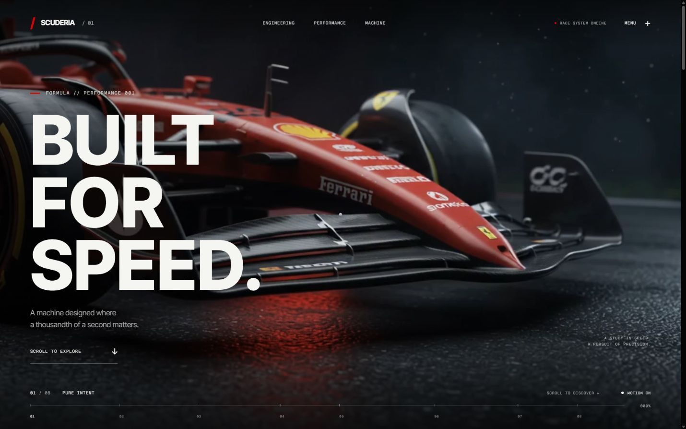
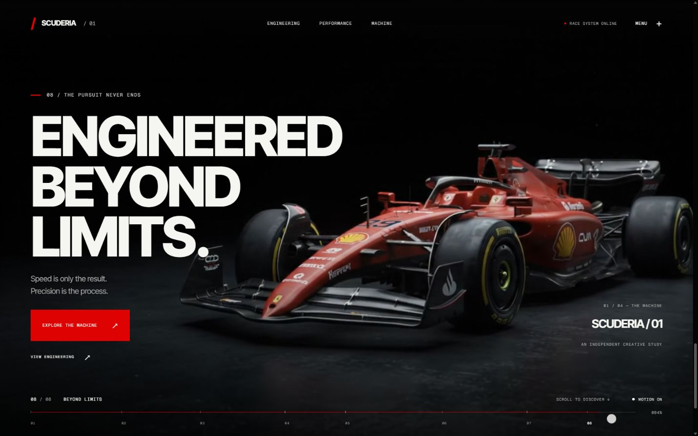
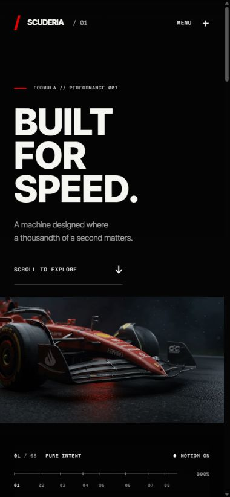
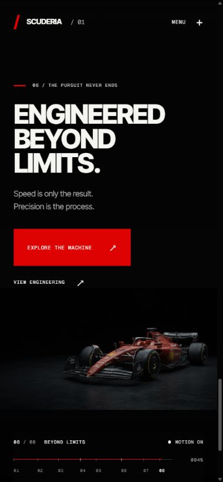

# Phase 1 verification

Verified locally on 2026-08-28 (Asia/Bangkok). No deployment was performed.

## Checks passed

- Development server starts at http://127.0.0.1:3000.
- Canonical MP4: HTTP 200 for HEAD, video/mp4, 3,682,468 bytes.
- Byte-range request: HTTP 206, bytes 0-1023/3682468. No video 404.
- Browser decodes the supplied 1280×720, 10.005-second MP4.
- Original and approved copy match SHA256
  `87c32c428b138f38313431ce99fce5fbbe44954682243611da583ba3d5f49194`.
- All eight chapter links reach the correct scene and seek the video.
- Intermediate beats verified: 300 → zero hesitation; not just a car → a system;
  one machine → thousands of decisions.
- Reverse wheel scrolling restored 300 from zero hesitation. Video time moved
  backward from 3.848387 s to 3.161175 s.
- At 100% the paused video reached 9.988333 s, safely before its 10.005 s duration.
- Full reverse restored the opening heading, 0% progress and video time 0.
- Final primary CTA navigates to the machine; engineering links navigate to the
  engineering chapter. Menu chapter links work on mobile.
- Menu Escape dismissal and focus restoration to MENU were verified after fixing
  an initial keyboard issue.
- Reduced mode exposes all 8 semantic scene regions and both text beats. The
  video remains paused at time 0 after scrolling; no scrub continues.
- No horizontal overflow at desktop 1440×900, tablet 768×1024,
  portrait 390×844 and 360×640, or landscape 844×390.
- Every chapter was checked at 360×640. All content ends above the fixed footer.
- Landscape engineering, performance, and final layouts were checked after fixing
  overlap. Their content bottoms are 280.44, 298.41, and 284.84 pixels;
  footer starts at 309.40 pixels.
- Browser console captured no errors or warnings during the checked flows,
  including no hydration errors.
- `npm run lint`, `npm run typecheck`, and `npm run build` pass.
- Static assertions pass: eight contiguous ranges spanning 0–1; copied media
  integrity; no GLB; no Canvas/model import in the experience; videos not ignored.
- Production JS scan found no Three.js renderer / R3F module markers.

## Scope and limitations

Testing used Chromium with viewport overrides, not physical iOS/Android devices.
The reduced-motion behavior was tested through the page's motion toggle, which
uses the same rendering and animation-disable branch as the system preference.
The operating-system preference itself was not changed during testing.

The error/retry/15-second timeout and text-only fallback are implemented; a
deliberate network or codec failure was not injected into the supplied MP4.
The original asset was never moved, renamed, re-encoded, or replaced.

No GLB exists. No Three.js model, primitives, Canvas, 3D handoff, or interactive
exploded view was created. Exploded imagery visible in the film belongs to the
user-supplied footage.

## Files changed

Modified:
- `app/layout.tsx`, `app/page.tsx`, `app/globals.css`
- `components/experience/F1Experience.tsx`, `VideoSequence.tsx`,
  `ScrollDirector.tsx`, `F1Canvas.tsx`, `F1Model.tsx`, `Lighting.tsx`
- `components/typography/SplitHeading.tsx`, `RevealText.tsx`,
  `TechLabel.tsx`, `Metric.tsx`
- `components/ui/Navigation.tsx`, `CustomCursor.tsx`, `Loader.tsx`
- `hooks/useScrollProgress.ts`, `hooks/useMediaQuery.ts`
- `lib/animation.ts`, `lib/scroll.ts`, `lib/constants.ts`
- `types/index.ts`, `next.config.ts`, `README.md`

Created:
- `components/experience/F1Experience.module.css`
- `components/ui/Navigation.module.css`, `components/ui/Loader.module.css`
- `public/videos/ferrari-f1-hero.mp4` (approved copy)
- This report, `measurements.json`, and four screenshots in this folder.
- Next.js generated `AGENTS.md` and `CLAUDE.md` when the dev server started.

The existing dependency set and package lock were preserved.

## Evidence

Detailed browser measurements: [measurements.json](./measurements.json).

